# Two-Phase Interleaved Boost DC–DC Converter

**Converter simulation • Digital control • Analog ACMC • MATLAB/Simulink • LTspice • PCB layout**

A technical portfolio covering the **modeling, controller design, and simulation** of a two-phase coupled-inductor interleaved boost DC–DC converter. The repo includes editable **LTspice** schematics, a **Simulink** model, a **MATLAB** parameter/control-design script, and selected simulation plots.

> **Scope:** The performance figures shown here are from *simulation*, not hardware validation or certified compliance. This repository combines materials from different development iterations; individual files do not necessarily use an identical set of parameters. Sharing and reuse of collaboratively developed materials are subject to the applicable permissions.

## Project at a glance

| Item | Comparative study configuration |
|---|---|
| Topology | Two-phase, 180° interleaved boost with inversely coupled windings |
| Output | 28 V DC, 280 W rated |
| Input range | 12–28 V; nominal 14 V |
| Switching frequency | 100 kHz |
| Control | Cascaded average current-mode control (ACMC): two current loops and one voltage loop |
| Analog model | LTspice, Type-II compensation |
| Digital model | MATLAB/Simulink, digital PI compensation |
| Digital sampling | Inner loop 10 µs; outer loop 100 µs |

The values above describe **one simulation comparison configuration**, *not every source-file revision*. For example, the uploaded `parametre.m` script initializes a **14 V → 24 V, 240 W** variant, with 3 µH leakage inductance. See [Reproducibility and revision notes](docs/REPRODUCIBILITY.md) before running or comparing results.

## PCB design overview

The following design views are shared for illustration of the physical layout workflow; no native KiCad design files are included in this release.

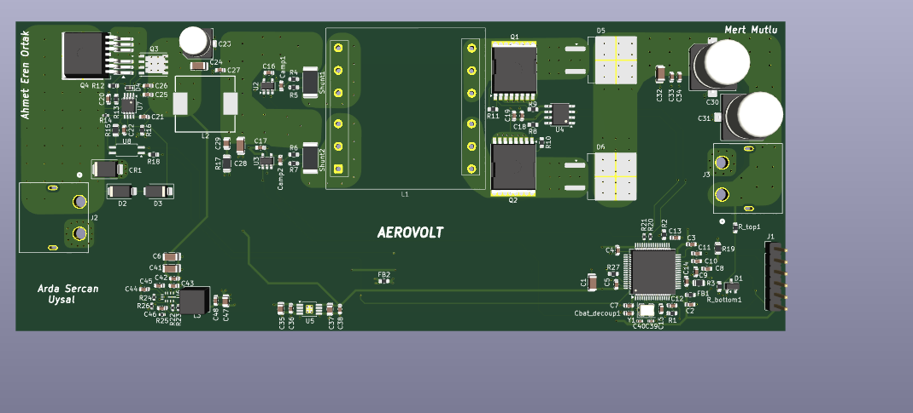

More PCB views

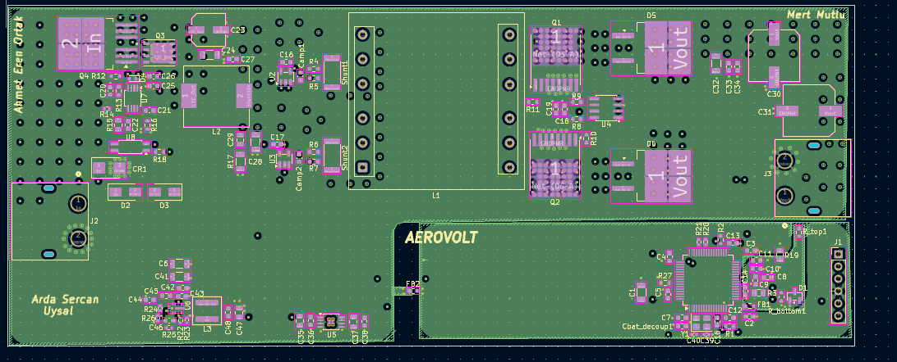
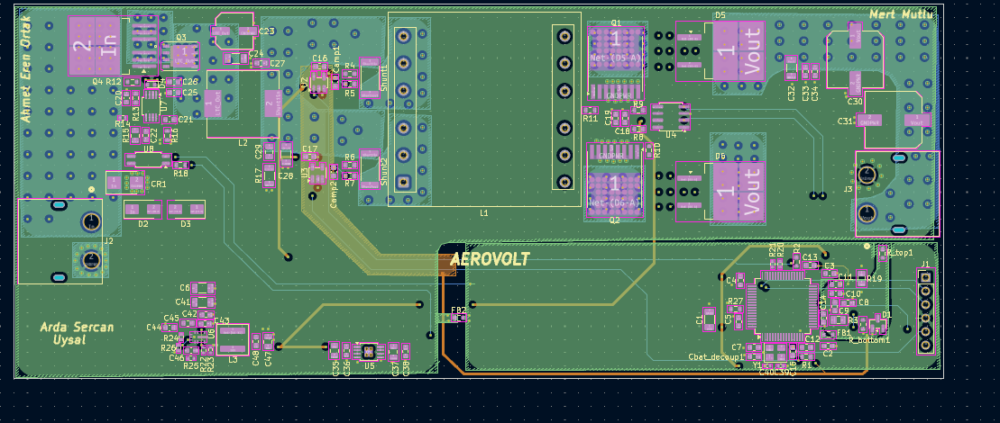
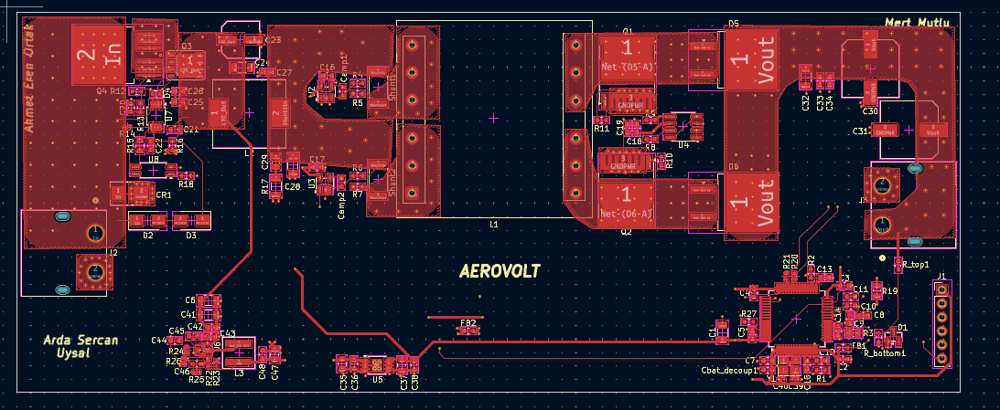
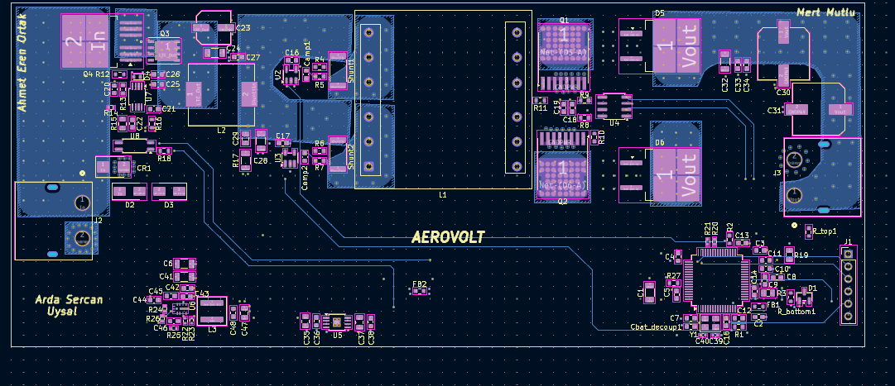

## Control strategy

A faster **inner current regulation loop** is nested within a slower **outer voltage regulation loop**. The digital PI implementation uses the **Tustin (bilinear)** discretization:

$$u[k] = u[k-1] + q_0 e[k] + q_1 e[k-1]$$

$$q_0=K_p+\frac{K_iT_s}{2},\qquad q_1=-K_p+\frac{K_iT_s}{2}$$

The analog model uses Type-II compensation; both models are intended to explore transient response, regulation, and stability trade-offs.

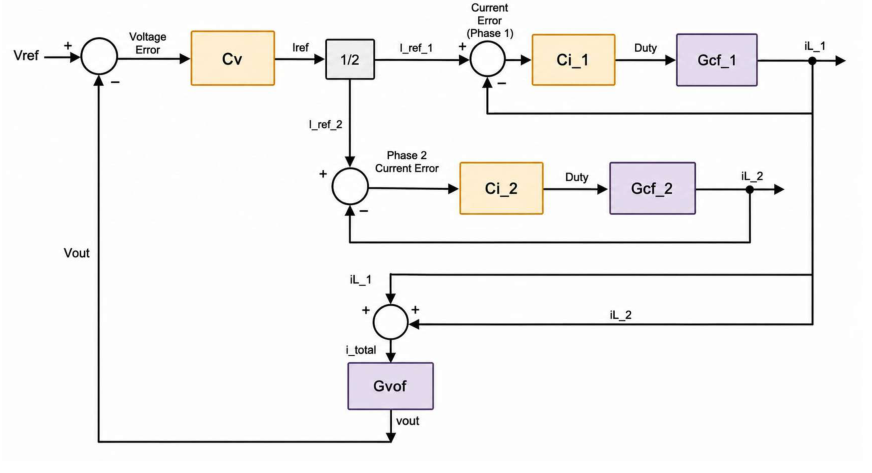

### Analog Type-II Compensation Design

The analog implementation employs a cascaded Average Current Mode Control (ACMC) architecture, consisting of two independent inner current-control loops and an outer voltage-control loop. All three loops utilize operational amplifier-based Type-II compensators to improve stability, steady-state regulation, and transient performance.

A Type-II compensator introduces an integrator, a zero, and a high-frequency pole. The integrator provides high low-frequency gain to minimize steady-state error, the zero contributes phase boost to improve stability, and the high-frequency pole limits the amplification of switching-related noise.

The ideal compensator transfer function can be expressed as:

$$G_c(s)=K\frac{1+s/\omega_z}{s(1+s/\omega_p)}$$

where \(\omega_z\) and \(\omega_p\) represent the compensator zero and high-frequency pole, respectively.

#### Inner Current-Loop Compensation

Two identical Type-II compensators independently regulate the inductor currents of the interleaved phases. The current loops are designed to respond rapidly to current disturbances while maintaining stable operation.

The implemented compensation networks use the following component values:

| Parameter | Value |
|---|---|
| Compensation resistor | 1.6 kΩ |
| Series capacitor | 47 nF |
| Parallel capacitor | 2.2 nF |
| Approximate zero frequency | 2.12 kHz |
| Approximate high-frequency pole | 47.3 kHz |

The compensation zero provides phase boost in the current-loop frequency range, while the high-frequency pole limits the compensator gain at higher frequencies.

#### Outer Voltage-Loop Compensation

The outer voltage loop regulates the converter output by generating the reference for the inner current-control loops. Its intended bandwidth is lower than that of the current loops, allowing the inner controllers to respond more rapidly to current disturbances.

The implemented voltage-loop compensation network consists of:

| Parameter | Value |
|---|---|
| Compensation resistor | 17 kΩ |
| Series capacitor | 300 nF |
| Parallel capacitor | 1.2 nF |
| Approximate zero frequency | 31.2 Hz |
| Approximate high-frequency pole | 7.83 kHz |

The low-frequency compensator zero supports voltage regulation and contributes phase boost, while the high-frequency pole attenuates high-frequency disturbances.

#### Compensation Design Considerations

The compensation networks were developed to provide a bandwidth separation between the inner current loops and the outer voltage loop. This cascaded structure enables the current controllers to handle rapid current variations while the slower voltage controller maintains the regulated output.

The zero and pole frequencies reported above are calculated from the ideal RC compensation networks. Actual loop crossover frequencies and phase margins depend on the complete converter dynamics and must be evaluated through small-signal frequency-response analysis.

The final compensation networks are implemented in the LTspice analog control model, allowing their behavior to be evaluated under different operating conditions.

### Frequency-domain analysis

The small-signal tuning methodology examines **crossover frequency**, **phase margin**, and the relative bandwidths of the current and voltage loops. The following figure illustrates the frequency response of the inner-current and outer-voltage control loops:

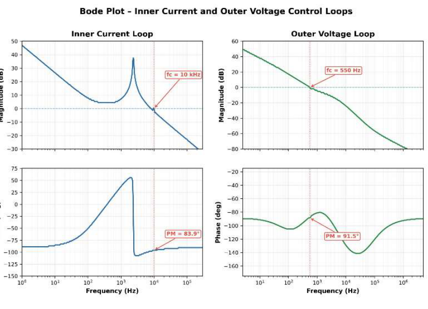

## Simulation results

These plots come from the supplied simulation exports. The model settings should be verified before using them to reproduce the study comparison.

### Output-voltage response at multiple input voltages

| 12 V input | 14 V input |
|---|---|
| 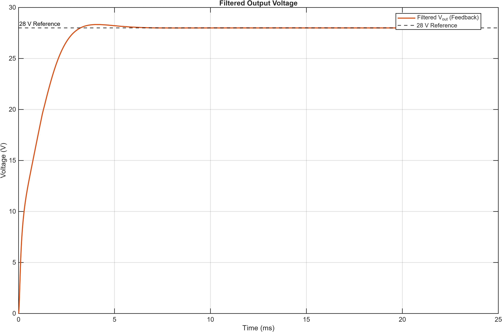 | 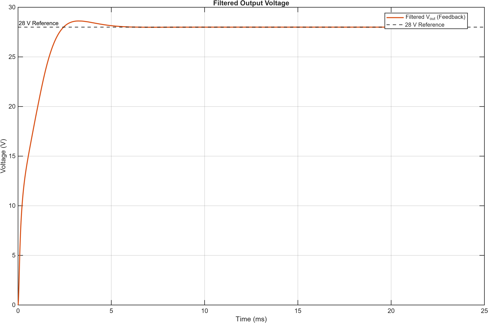 |

| 20 V input | 24 V input |
|---|---|
| 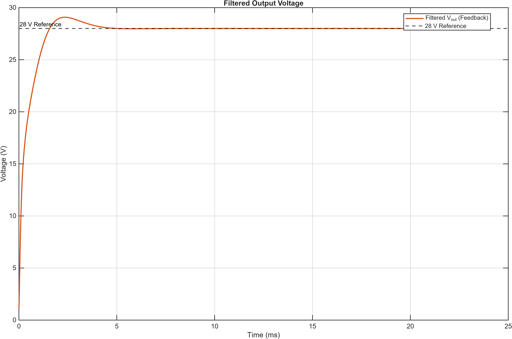 | 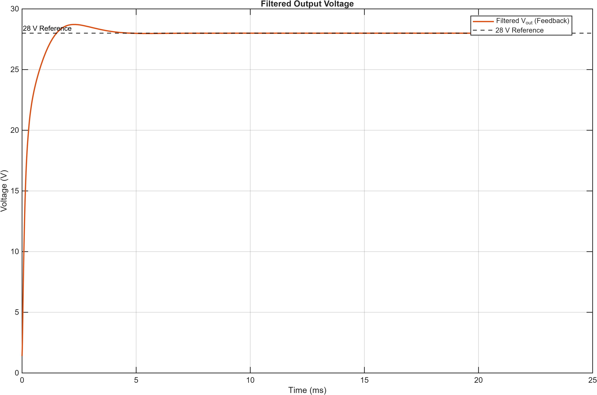 |

### Detailed waveforms

- [12 V input: currents, ripple, raw and filtered output](results/digital/12V)
- [14 V input: currents, ripple, raw and filtered output](results/digital/14V)
- [20 V input: currents, ripple, raw and filtered output](results/digital/20V)
- [24 V input: currents, ripple, raw and filtered output](results/digital/24V)
- [Additional high-resolution 14 V plots](results/additional)

Example 14 V ripple waveform:

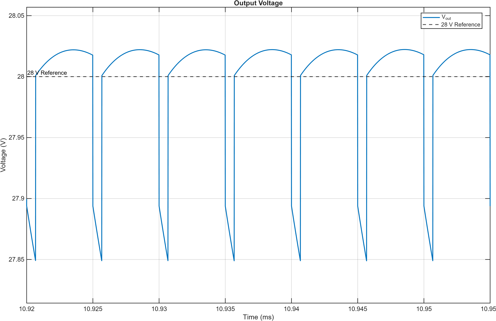

### Analog-versus-digital comparison

The available simulation results report the following **load-decrease transient metrics** at the **14 V nominal input**:

| Metric | Analog ACMC | Digital ACMC |
|---|---:|---:|
| Overshoot | 8.39% | 7.14% |
| Recovery time | 3.28 ms | 2.05 ms |

These are **simulated results**, not measurements from a fabricated converter. Results must not be interpreted as independent certification to MIL-STD-704F or any other standard.

## Source files and usage

| Directory | Files | Software |
|---|---|---|
| [`simulation/ltspice/`](simulation/ltspice) | `Analog_ACMC.asc`, `Analog_ACMC_variant.asc` | LTspice |
| [`simulation/matlab/`](simulation/matlab) | `parametre.m` | MATLAB + Control System Toolbox |
| [`simulation/simulink/`](simulation/simulink) | `Digital_ACMC.slx` | MATLAB/Simulink (required blocks/toolboxes may vary) |
| [`results/digital/`](results/digital) | Digital simulation plots for 12, 14, 20, 24 V | PNG viewer |

**Quick start:**

1. Open an `.asc` file in LTspice and check that its referenced device libraries are available. Select the proper simulation command inside the schematic.
2. Open MATLAB, inspect `simulation/matlab/parametre.m`, and run it to populate the workspace for that *script's* 24 V / 240 W configuration.
3. Open `simulation/simulink/Digital_ACMC.slx` in Simulink. **Inspect and align all model parameters before running**; the supplied MATLAB script and Simulink model are not guaranteed to be matching final revisions.
4. Compare outputs against the corresponding simulation figures only when operating conditions, load steps, and component values match.

The `.slx` model and simulation schematics were not executed or independently verified in this environment.

## Engineering methods illustrated

- Coupled-inductor interleaved boost power stage
- Small-signal modeling and transfer-function loop design
- Nested PI regulators and average current-mode control
- Digital Tustin discretization, sampling constraints, and anti-windup
- Bode analysis and transient-load tests
- Layout visualization and design-for-integration considerations

## Project Team & Contributors

This project was developed collaboratively. The team members are listed below.

| Team member | GitHub |
|---|---|
| Arda Sercan Uysal | [@SrcnUysl](https://github.com/SrcnUysl) |
| Ahmet Eren Ortak | [@ahmeterenortak](https://github.com/ahmeterenortak) |
| Mert Mutlu | [@GaziOsmanPasha](https://github.com/GaziOsmanPasha) |

Contributor names here acknowledge project participation; GitHub's automatically generated **Contributors** statistics are based on commit history.

## Attribution and reuse

This portfolio contains simulation models, visualizations, and engineering materials prepared in a collaborative technical setting. Inclusion here does not imply sole authorship of each item or authorize unrestricted third-party redistribution. Any reuse must comply with the applicable ownership and permission requirements.

No open-source license is assigned at this stage.
