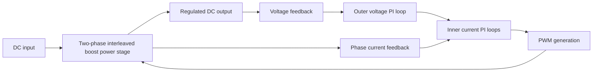

# Interleaved Boost DC–DC Converter

### Power Electronics · Converter Modeling · Digital Control

A public-facing engineering portfolio overview focused on **two-phase interleaved boost conversion** and **digital control methods**. The repository presents the technical areas explored without exposing project-specific designs, measurements, source files, or other potentially restricted information.

> **Disclosure scope:** This is a high-level portfolio summary, **not** an open-source release of the underlying project. No confidential hardware, firmware, simulation models, proprietary specifications, or sponsor materials are included.

## Engineering focus

| Area | Topics |
| --- | --- |
| Power conversion | Two-phase interleaved boost topology, switching behavior, passive-component considerations |
| Control systems | Cascaded voltage/current regulation, PI control, loop interaction |
| Digital control | Discrete-time PI implementation, Tustin (bilinear) discretization, output limiting and anti-windup |
| Analysis | Transfer functions, Bode plots, crossover frequencies, gain and phase margins, transient response |
| Design workflow | MATLAB/Simulink-based analysis; KiCad schematic, layout, and 3D review methodologies |
| Embedded systems | PWM generation, ADC sampling, and control-loop scheduling concepts |

## Conceptual system architecture

The following diagram is **illustrative**, rather than a reproduction of project-specific hardware or firmware.

## Design and analysis methodology

### 1. Converter behavior
- Study the switching operation and energy transfer of the interleaved boost topology.
- Consider current ripple, phase relationships, magnetic components, and output filtering.
- Evaluate the trade-offs between switching frequency, losses, and dynamic performance.

### 2. Cascaded control
- Model the relevant converter dynamics using small-signal transfer functions.
- Design the current loop before closing the outer voltage loop.
- Use frequency-response analysis to inspect stability margins and loop bandwidth.
- Assess reference tracking, disturbances, and controller limits.

### 3. Digital implementation
- Convert continuous-time PI control laws to discrete time where appropriate.
- Account for controller sampling periods, PWM timing, saturation, and anti-windup.
- Compare idealized modeling assumptions against the constraints of an embedded implementation.

### 4. Verification workflow
- Evaluate conceptual responses in simulation.
- Document assumptions and operating conditions for each analysis.
- Distinguish calculated or simulated results from physical measurements.

## Repository contents

This initial public release contains **documentation only**. Detailed models, CAD files, firmware, PCB layouts, numerical design parameters, and performance plots are intentionally excluded.

Any future additions will be reviewed for disclosure rights and accurate attribution before publication.

## Tools and technical areas

MATLAB · Simulink · KiCad · Power Electronics · Digital PI Control · Frequency-Domain Analysis · Embedded Control

## Notes on publication and reuse

This summary discusses general engineering techniques. It does not assert that any particular hardware prototype was manufactured, tested, qualified, or publicly approved for technical release. No license is granted for underlying project materials.

---

**Author:** [SrcnUysl](https://github.com/SrcnUysl)  
**Purpose:** Engineering portfolio and technical overview.
